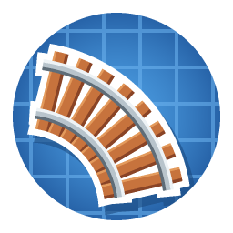

# Create: Railways Unlimited

Addon for [Create](https://modrinth.com/mod/create) 6.0.10+ on Minecraft 1.21.1 (NeoForge) that lets straight
train track run at multiples of **5°, 15°, 30° or 45°** instead of only 0° and 45°.

## Usage

- **Settings:** wear Engineer's Goggles, hold track and press **G** (rebindable in Controls). Settings are stored per
  player and per world:
  - angle step (5° / 15° / 30° / 45°, default 45°) and maximum segment length (32–512 blocks);
  - preview by track type (only with Steam 'n' Rails: wide / narrow gauge, monorail);
  - debug: show joints, remove "ghost" track graph nodes around you.
- **Place track like in Create:** click an existing track, then click where the new track should end. The end
  direction follows where you look, snapped to the chosen step.
- **Keys while connecting track** (shown under the hotbar, the active one lights up):
  - **Left Control:** widest possible turn (without it: the smallest one, like Create);
  - **Left Alt:** straight track, ending at the aimed block's height (aiming into the air: the start's height);
  - **Y:** keep the height; **X:** keep the grade the previous piece was built with (only one of the two at a time).
- **Goggle overlay:** while wearing goggles and holding track, the angle, step and grade of the track about to be
  placed are shown next to the crosshair.

## How it works

Angled pieces are ordinary Create curves (`BezierConnection`) between invisible *anchor* blocks that use Create's own
track block entity. That keeps stations, signals, train navigation and map mods such as Create Track Map working
without gaps. Straight curves do not slow trains down like real curves do.

Slopes behave like Create's: a free end lies flat, continuing from it tilts the joint so the hill runs on, level
track after a hill leaves the hill as it is, and a Create track block between two slopes is tilted to their average.

## Limitations (0.1.0-beta.2)

- Trains can stop at stations on angled track, but are assembled on 0°/45° track as in Create.
- Girders and paving from the off-hand are not applied to angled pieces yet.
- Angled track cannot start from or end on Create's steep slope blocks.

## Development

`.\dev.ps1` starts the dev client, `.\dev.ps1 runGameTestServer` runs the automated in-game tests,
`.\dev.ps1 build` builds the jar into `build\libs`. Dev runs also load Create Track Map (web map at
http://localhost:3876) and Steam 'n' Rails; neither is a dependency of the mod.
